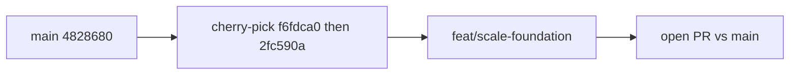

# Scale foundation (PR 2 only)

Approved: leftovers as a small PR, then PR 2. Do not re-implement PR 1. Do not recreate the old stacked rebase.

GitHub and local [`main`](https://github.com/Nasalciuc/BBC-Club) are both [`4828680`](https://github.com/Nasalciuc/BBC-Club/commit/482868007c3b9d0c88db512c2429fc36270f1af0) — squash **[#43](https://github.com/Nasalciuc/BBC-Club/pull/43)**. Parent [`75f5c81`](https://github.com/Nasalciuc/BBC-Club/commit/75f5c81) (#42). Open PRs: none.



---

## #43 review leftovers (still on main — squash dropped them)

The three threads you pasted are **still true on `4828680`**. Replies cited `2fc590a` / `f6fdca0`, but those commits are **not ancestors of main**. They live on [`origin/dev/charming-dirac-5iwixs`](https://github.com/Nasalciuc/BBC-Club/tree/dev/charming-dirac-5iwixs). CodeRabbit already said the destructive-regex fix was not on the PR head that got merged.

On current `main`:

- [`packages/db/test/migrate-lock.test.ts`](packages/db/test/migrate-lock.test.ts) still `await Bun.sleep(200)` after `LOCK TABLE` (lines 22 and 62). No `Promise.withResolvers`.
- [`packages/modules/domain/proposals/src/application/ingest.ts`](packages/modules/domain/proposals/src/application/ingest.ts) `replay()` still compares eight fields (`source` … `title`). `validUntil`, `publishedPrice`, `body`, `currency`, `publishAt`, `flightFacts`, `mediaUrl`, `createdBy` are ignored. [`ingest-idempotency.contract.test.ts`](packages/modules/domain/proposals/tests/contract/ingest-idempotency.contract.test.ts) has no per-field CONFLICT cases.
- [`scripts/check-destructive-migrations.ts`](scripts/check-destructive-migrations.ts) `DESTRUCTIVE` still lacks `DROP SCHEMA`; `DELETE_WITHOUT_WHERE` still requires a trailing `;`.

Same commit `2fc590a` also tightens [`schema-parity.test.ts`](packages/db/test/schema-parity.test.ts) (index name match must also compare columns / partial). Include that; it is not on main either.

**Executing:** branch `fix/pr43-review` from `origin/main`, cherry-pick **`f6fdca0` then `2fc590a`** (dry-run clean on 4828680). Do not rewrite the diffs by hand unless the cherry-pick conflicts. Open a small PR vs `main`. Then `feat/scale-foundation` from the leftover branch (or from `origin/main` after squash-merge).

---

## What #43 already landed (do not redo)

- Campaigns: [`audiencePage`](packages/modules/core/members/src/api/index.ts) keyset, [`0018_notifications_campaigns.sql`](packages/db/migrations/0018_notifications_campaigns.sql), [`campaign-fanout`](packages/modules/core/notifications/src/module.ts), [`on-offer-published.ts`](packages/modules/core/notifications/src/application/on-offer-published.ts) inserts a campaign row (not per-member). WITHDRAWN / EXPIRED close open campaigns before suppress.
- Profile: [`ADR-IMPL-025`](docs/adr/ADR-IMPL-025-profile-notifications-and-fixture-validity.md), [`to-profile-vm.ts`](apps/api/src/presentation/mobile/to-profile-vm.ts), [`NotificationsSheet`](apps/mobile/src/components/NotificationsSheet.tsx) from saved GET profile. **`useProfile()` never existed** — do not invent it. `getProfile` hides deleted. fa01 valid through 2027.
- DB: [`packages/db/src/client.ts`](packages/db/src/client.ts) is **typed** (no `@ts-nocheck`). `query()` + `RowShapeError`. `Executor` used by `withTx` / `withAdvisoryLock`. `col()` ratchet. Schema catch-up, leftover `0007_catalog` / `0007_requests` **deleted**. `lock_timeout` 5s in migrate. Eighth enum-order drift (`sending` last). Job `job_runs` insert **inside try** so a failed insert does not hold the advisory lock.
- E2E: [`.github/workflows/e2e-android.yml`](`.github/workflows/e2e-android.yml`) on main (KVM check, `NODE_ENV=production` for APK, Gradle Metaspace 4g, pixel_6, hideKeyboard, include-hidden-files). Entry keyboard vs DESIGN.md footer docking is a **documented follow-up — do not touch Entry**.
- Graph: G12 ~69; raw-SQL baseline ~98. Next ADRs **026 / 027**. Next migrations **0019+**.
- Still **not** on main: `APP_ROLE`, `DB_POOLER`, `worker.ts`, PgBouncer, rolling deploy, GlitchTip own Postgres, 60s cookie cache, volume seed, k6, `pg_stat_statements`, `planOf`. [`createDb`](packages/db/src/client.ts) still has `prepare: true` and `statement_timeout: 15_000` in `connection`. [`cookieCache.maxAge`](packages/modules/core/identity/src/infrastructure/auth.ts) is still **300s**. [`deploy.sh`](infra/deploy.sh) still 7-step whole-service `/ready` (no `rollback_and_exit`). Caddy still a **single** `api:8000`.

Constraints unchanged: no `isolated/` into `src/`; no `poller.ts` any-retype; do not delete `feat/cpu-and-behaviour`; never run the app or Maestro; React Compiler (no `useMemo` / `useCallback` / `memo`); no force-push; PowerShell — no `&&`; `GH_TOKEN` from git credential, never print.

---

# PR 2 — `feat/scale-foundation`

```bash
git fetch origin
git switch -c feat/scale-foundation origin/main
graphify update . --force
python scripts/graph-questions.py apps/api/src/index.ts packages/db/src/client.ts packages/modules/platform/src/jobs/index.ts packages/modules/core/identity/src/infrastructure/auth.ts packages/shared/src/env.ts infra/docker-compose.yml
python scripts/graph-shape.py
```

Open the PR against **`main`**. Re-read cited lines on `4828680` (typed `client.ts`, `0018`, ADR-025). **Do not** reintroduce `@ts-nocheck` on client. **Do not** put campaigns in `domain/campaigns`. Worker must stay **direct** because of the session advisory lock (`db.raw.reserve()` is unsafe through the pooler).

**Today’s deploy (describe in the PR before A3 changes it):** [`deploy.sh`](infra/deploy.sh) 1 pg_dump → 2 pull image → 3 migrate (`run --rm --no-deps`, fail keeps old API) → 4 `up -d` the **whole** api service → 5 `/ready` inside the container (12×5s) → 6 inline rollback of previous image tag (there is **no** `rollback_and_exit` function today) → 7 prune. Compose healthcheck is `/health`; deploy gate is `/ready`. Caddy [`api_site`](infra/caddy/Caddyfile) reverse-proxies a **single** `api:8000`. [`cookieCache.maxAge`](packages/modules/core/identity/src/infrastructure/auth.ts) is **300s**. GlitchTip uses the **app Postgres host**, database `glitchtip`. No `worker.ts`, no `APP_ROLE`, no `seed-volume.ts`, no `loadtest/`, no `pg_stat_statements`. Custom image [`infra/postgres/Dockerfile`](infra/postgres/Dockerfile) installs pgBackRest only — **VERIFY FIRST** that contrib/`pg_stat_statements` is present before C1.

PR 2 ADRs: **026** (one worker owns poller+jobs on a direct connection; API serves members only; covers `APP_ROLE` + `DB_POOLER`) and **027** (session cookie cache lifetime, recommend 60s). Migrations after 0018: `ALTER ROLE bbc SET statement_timeout = '15s'` then `pg_stat_statements` (next free `00NN`).

Part A’s **staging** gate (rolling deploy, PgBouncer under load) needs the staging host. **Parts B and C may be written and tested locally before staging is up**; do not treat PR 2 as done until Gate A on staging is green.

---

## PR 2 Part A — scale foundation (A1–A6)

**A1 — roles.** `APP_ROLE: all|api|worker` (default `all` for tests/dev), `WORKER_PORT` default 8001. [`buildApp`](apps/api/src/index.ts): `serveMembers` / `runsBackground`; registry still boots every module; auth+module routes only if serving members; job HTTP + poller only if background. `/health` `/ready` `/metrics` on every role. New [`apps/api/src/worker.ts`](apps/api/src/worker.ts): `idleTimeout: 120`, SIGTERM `server.stop(false)` then `shutdown()`. Compose: `api` → `APP_ROLE=api`; `worker` image same SHA, `command bun apps/api/src/worker.ts`, **direct** `DATABASE_URL` to postgres, `stop_grace_period: 60s`, not published (edge for cron only). Cron `API_URL: http://worker:8001` (keep the name [`job.sh`](infra/cron/job.sh) reads). `deploy.sh` rolls worker after api, `/ready` on 8001. Tests: `role: "api"` → poller off, `POST /v1/internal/run/dispatch` **404**; `role: "worker"` → `/v1/home` 404, job route works; inventories stay on `"all"`; `cron-parity` green.

**A2 — PgBouncer.** VERIFY FIRST: maintained image, pin **≥ 1.21**, read env/ini contract. Transaction pooling: `pool_mode=transaction`, `max_client_conn=2000`, `default_pool_size=20`, `reserve_pool_size=5`, **no** `server_reset_query=DISCARD ALL` in transaction mode, `auth_type=scram-sha-256`, `ignore_startup_parameters=extra_float_digits`. Network `data` only. API `DATABASE_URL` → pgbouncer, `DB_POOLER=transaction`. Worker, migrations (`deploy.sh` step 3), seeds: **direct**. [`createDb`](packages/db/src/client.ts): add `pooler?: "none"|"transaction"`; **defaults unchanged** for the 50 importers; when `transaction`: `prepare: false`, **no** `statement_timeout` startup param. Host: `createDb(env.DATABASE_URL, { applicationName: "bbc-api", pooler: env.DB_POOLER })`. Migration: `ALTER ROLE bbc SET statement_timeout = '15s'`. Grep API-role path for `SET ` without `LOCAL`, `LISTEN`, `pg_advisory_lock`, temp tables, `.reserve()` — list in PR; none after A1. `/ready`: two parameterised queries with 2s timeout (hanging pooler fails readiness). `pooler.test.ts` in CI against compose: probes from the prompt (startup param rejected; prepare true hangs; prepare false ok; 15s cancel `57014`). `SHOW POOLS` ≤ 20 server connections. Add a **PgBouncer service to [`infra/compose.test.yml`](infra/compose.test.yml)** so `pooler.test.ts` runs in CI against the same file as `test:db` (not only production compose).

Do not reintroduce `@ts-nocheck`. `withTx` already uses typed `Executor` — keep it.

**A3 — N replicas + drain + rolling deploy.** `API_REPLICAS` default 4, 1 CPU / 512m per Bun process, **no** `container_name`, `stop_grace_period: 20s`. Caddy: VERIFY FIRST `dynamic a` + passive health vs pinned Caddy 2 docs; `caddy validate` in CI; `lb_policy least_conn`, `lb_try_duration 5s`, etc.; `import api_site api` / `api-staging` with port inside the snippet. Drain: `/ready` 503 while draining, sleep 5s, `server.stop(false)`, then `shutdown`. Extract a real `rollback_and_exit` (today’s previous-image restore + notify). Rolling: start new generation beside old (`scale 2N`), wait `/ready` on **new** containers, stop old (SIGTERM → drain), scale back to N. RUNBOOK: Deploy rewrite; per-replica metrics/cache; DB gauges remain exact. VERIFY: `API_REPLICAS=4` spreads; `docker kill` one replica under load → no extra 5xx beyond in-flight; broken image rolls back.

**A4 — GlitchTip own Postgres.** `glitchtip-postgres` + `GLITCHTIP_DB_PASSWORD` in production.env.example. App `\l` has no `glitchtip` database. RUNBOOK: GlitchTip is not in the pgBackRest stanza.

**A5 — session cache.** Env `SESSION_COOKIE_CACHE_SECONDS` min 10 max 300 default **60**. Wire `cookieCache.maxAge`. Test with `"10"`: two devices, password change + `revokeOtherSessions`, sleep 11s, other device `GET /v1/profile` → **401**. VERIFY FIRST Better Auth **1.6.31** `asResponse` / `returnHeaders` for A6 sessions.

**A6 — load test in repo.** `packages/db/scripts/seed-volume.ts` as specified (`--scale=1`, mulberry32, 1k-row inserts, hash password once). `loadtest/make-sessions.ts` server-side sign-in → `loadtest/sessions.json` **gitignored**. `loadtest/k6/mixed.js` as specified. `LOADTEST_TRUSTED_PROXIES` only if `LOADTEST=1`; **`deploy.sh production` refuses `LOADTEST=1`**. `bun run loadtest:smoke` = 50 RPS / 60s local. Full k6 never against production. `docs/perf/CAPACITY.md` (model table + formula) and `docs/perf/YYYY-MM-DD.md` after the first real run.

**Gate A:** `validate` · API suite through PgBouncer **and** direct · `API_REPLICAS=4` + worker up locally · `loadtest:smoke`. **On staging:** rolling deploy under load, forced rollback. Only then consider Part B “honest” (volume seed exists). If staging is down, still write B/C locally.

---

## PR 2 Part B — performance in CI (B1–B4)

Session file is source for helpers and the hot-query registry. Verified on **200 000 rows after ANALYZE**.

**B1.** [`packages/db/src/testing/plan.ts`](packages/db/src/testing/plan.ts) **exactly** as the session: `planOf`, `nodes`, `usesIndex`, `seqScans`. Assert properties, never plan text.

**B2.** [`packages/db/test/hot-queries.test.ts`](packages/db/test/hot-queries.test.ts): volume seed, `ANALYZE`, then each `HOT` entry asserts **`usesIndex(p, q.index)`** and `seqScans` not on `noSeqScanOn`. A switch to a worse index must fail. **No `Total Cost` assertion.** Build each `statement` from the same query builders the app uses. Existing `enable_seqscan = off` tests stay.

**B3.** [`apps/api/test/query-budget.test.ts`](apps/api/test/query-budget.test.ts): counting logger, budgets measured on the fixture then enforced (`GET /v1/home`, search, fare, requests, profile, `POST /v1/requests`). Fail with the query list. This is query **count**, not plan cost.

**B4.** Drop **nothing**. No destructive migration. [`packages/db/test/index-redundancy.test.ts`](packages/db/test/index-redundancy.test.ts): the 28 Sep query (0 redundant among 100) — a non-unique, non-partial, non-expression index whose columns are a prefix of another index on the same table fails, naming both. Skip partitions (`NOT relispartition`). Scratch duplicate → fail. Seeded data cannot tell what production does not use.

---

## PR 2 Part C — observability (C1–C5)

**C1.** `CREATE EXTENSION IF NOT EXISTS pg_stat_statements` (VERIFY FIRST on custom image). `pg_stat_statements.max=10000`, `track=all`. `reset_pgss` in tests that assert on it.

**C2.** Session gauges on `/metrics` (connections, oldest tx, lock waits, deadlocks, PgBouncer waiting). **There is no Prometheus or Alertmanager.** A worker job evaluates thresholds (`pool_waiting > 0` for 2 minutes, `oldest_tx > 30s`) and **POSTs to `OPS_WEBHOOK`**. Do not add a scrape stack.

**C3.** **Commit no report files.** Local/CI `pg_stat_statements` is not production. Job `db-report` (weekly, worker) + `GET /v1/internal/db-report` (`ops:read`) produce the report **on staging and production**. RUNBOOK says how to read it. Stats age (`pg_stat_database.stats_reset`); meaningful after ≥ 7 days of traffic.

**C4.** Session pool-full test: `createDb({ max: 2 })`, hold both connections, third waits then completes; `statement_timeout` still bounds runaways; pooled client has `prepare: false`. Do not hang the GitHub runner.

**C5.** RUNBOOK _Database health_: gauges, OPS_WEBHOOK thresholds, how to read `GET /v1/internal/db-report` / the weekly job. No Prometheus in this PR.

---

## PR 2 gate

- `bun run validate` + `python scripts/graph-shape.py`
- Push **no force**. Open PR vs `main`.
- STOP for review. Staging rolling deploy is part of Gate A when the host is up.

No `--onto` rebase and no `--force-with-lease`: #43 is already squash-merged; this branch starts on current `main`.
